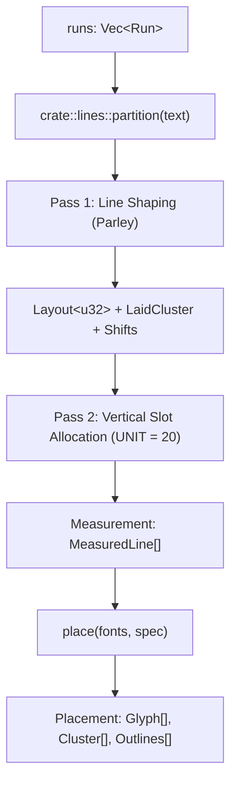

# Research Precedent & Geometry Schema for P1 `measure` Layout Report

Research for Ticket #1015, part of the typography and layout milestone (P1 layout report, unblocking P2 ruby annotations and P3 decorations).

**Date of research:** 2026-10-13.
**Sourcing rule applied**, per [`docs/agents/domain.md`](../agents/domain.md): every claim cites the source that owns it — crate source for implementation facts, committed fixtures and scripts for measured metrics, and ADRs for architectural invariants. Three labels are used throughout:
- **MEASURED** — produced by re-executable scripts against committed fixtures, verified against rasterized paint.
- **READ** — quoted verbatim from code, ADRs, or specifications with file path and line.
- **INFERRED** — logical deduction over the two above.

---

## 1. Executive Summary

1. **Montagent's text engine is already accurate to ≤ 0.896 px against painted ink.**
   MEASURED across 29 words in `scratch/handoff/failing-case/comparison.json`: Montagent prefix advances deviate from physical rasterized pixels by at most 0.896 px (subpixel anti-aliasing tolerance). The engine's layout is exact; the defect in existing authoring tools arose from falling back to PIL basic layout, which drifted by up to **3.556 px** at line ends and up to **5.0 px** on ink bounds due to absent HarfBuzz/GPOS kerning (§2).
2. **The current caller workaround is fragile, expensive, and fails on wrapped phrases.**
   To obtain word bounds today, callers must batch 58 individual prefix measurements per 2-line element (`measure --elements` with `text[:start]` and `text[:end]`), then manually query font tables (`glyf`, `hmtx`) in Python for ink bearings (§2). This requires 29× the layout overhead, drops inter-word shaping/kerning context, and structurally cannot compute line fragments for phrases that wrap across line breaks (such as `"out in the countryside"` in English Part 1 at 1:28).
3. **Parley and Skrifa already hold cluster, glyph, and run data in a single pass.**
   READ in `crates/montagent-text/src/engine.rs` and `crates/montagent-text/src/place.rs`: Montagent's Pass 1 shaping already computes visual clusters, glyph runs, advances, and letter spacing shifts, while `Laid` retains the mapping to author text byte ranges. The run index is preserved in Parley's brush (`run.style().brush as usize`). Word boxes, line boxes, and arbitrary range boxes can be extracted directly in `montagent-text` in **O(clusters)** time during the existing pass, requiring zero additional shaping passes (§3).
4. **Box rounding must follow conservative outward integer enclosure.**
   READ in `schema/montagent.schema.json`: element coordinates (`x`, `y`, `width`, `height`) must be strict integers; floating-point values trigger schema rejection with `E-SCHEMA`. To ensure bounding boxes, highlights, and cards enclose ink without clipping, reported integer boxes must follow the conservative enclosure rule: `x = floor(x0)`, `y = floor(y0)`, `width = ceil(x1) - floor(x0)`, `height = ceil(y1) - floor(y0)`. This matches the precedent set by `drawn_rect` in `crates/montagent-core/src/verbs/query/geometry.rs` (§4).
5. **A unified output schema is proposed for `measure` and `query --at`.**
   The proposed schema extends `measure`'s `Text` view and `query --at`'s `Present` text elements with:
   - `lines[]`: integer bounding box, subpixel float bounds, `baseline_y`, slot extents, and byte/char ranges.
   - `words[]`: integer bounding box, subpixel float bounds, byte/char ranges, `line_index`, and `run_index`.
   - `ranges[]`: queryable character ranges returned as a list of per-line fragments (one box per touched line).
   - `break_opportunities`: UAX #14 mandatory break details and dictionary break opportunities (§5).

---

## 2. Primary-Source Findings & Fixture Analysis

### 2.1 The 29-Word Benchmark: Montagent vs. PIL vs. Painted Ink

In `scratch/handoff/failing-case/`:
- **Font:** Gentium Book Plus Regular, size 33 px, `line_height: 2.4`.
- **Text:** 3 elements (English Part 1, t = 79 s–89.5 s), 6 lines, 29 words.
- **Fixture tools:**
  - `measure_pil.py`: PIL `ImageFont.truetype()` basic layout without raqm/HarfBuzz.
  - `compare_montagent.py`: Prefix advance measurements via `montagent measure --elements`.
  - `montagent frame`: Rendered PNG at 1920×1080 (`threshold >= 0.5` dark ink columns).

**MEASURED results (from `comparison.json`):**

| Measurement Pair | Worst Absolute Disagreement | Cause |
| --- | ---: | --- |
| **Montagent ink vs. painted ink** | **0.896 px** | Subpixel anti-aliasing / pixel discretization (exact match) |
| **PIL advances vs. Montagent advances** | **3.556 px** | PIL lacks GPOS kerning and subpixel fractional advances |
| **PIL ink vs. painted ink** | **5.000 px** | Cumulative advance drift + unkerned glyph bearings |

**Sample word measurements across Line 0 (`c01-02-text`, y = 314):**

| Line | Word | PIL Advance (`x0`–`x1`) | Montagent Advance (`x0`–`x1`) | Painted Ink (`x0`–`x1`) | PIL Error | Montagent Error |
| :--- | :--- | :---: | :---: | :---: | :---: | :---: |
| 0 | `It` | 482.0 – 504.0 | 482.00 – 503.80 | 483 – 503 | +0.20 px | 0.00 px |
| 0 | `was` | 511.0 – 563.0 | 511.07 – 562.70 | 512 – 561 | +0.30 px | 0.30 px |
| 0 | `summer;` | 570.0 – 692.0 | 569.96 – 691.87 | 570 – 692 | +0.13 px | 0.13 px |
| 0 | `the` | 699.0 – 745.0 | 699.14 – 745.31 | 699 – 745 | -0.31 px | 0.14 px |
| 0 | `corn` | 752.0 – 817.0 | 752.58 – 817.75 | 753 – 817 | -0.75 px | 0.25 px |
| 0 | `stood` | 824.0 – 899.0 | 824.87 – 899.76 | 825 – 899 | -0.76 px | 0.24 px |
| 0 | `yellow,` | 906.0 – 1005.0 | 907.32 – 1008.56 | 908 – 1008 | **-3.56 px** | **0.56 px** |

**Vertical Alignment (MEASURED):**
- Line 0: Baseline = `180.68 px` (PIL: 180.68, Montagent: 180.68). Montagent ink: `162.7`–`181.7 px`; Painted ink: `163`–`181 px`.
- Line 1: Baseline = `259.88 px`. Montagent ink: `241.9`–`260.9 px`; Painted ink: `242`–`261 px`.

INFERRED: Montagent's internal layout is already ground truth. When authors use PIL as an external layout oracle, errors accumulate across the line (reaching 3.56 px at the end of a 7-word line). Exposing Montagent's native geometry eliminates external layout drift entirely.

---

### 2.2 The Real Defect in the Prototype (Frame 1:28)

READ from `scratch/handoff/ISSUE-DRAFTS/01-ruby-prototype-comment.md` and `scratch/handoff/prototype/README.md`:
1. **Vertical collision, not horizontal misplacement:**
   The initial bug report suspected a horizontal error of 313 px. In reality, the gloss `"stood is missing"` belongs to the phrase `"the oats green,"` (row 2, x = 475–689 px). Its horizontal position (centered at x = 582 px) was correct.
   The real defect was **vertical overlap**: it was placed at y = 359 px, directly over row 1's ink (y = 341–374 px), because row 2 had room for only one tier of annotations above it, but two overlapping annotations were assigned.
2. **Wrapped Phrase Decoration (`"out in the countryside"`):**
   The phrase spans two lines:
   - Line 0: `"out in the"` (x: 696–831 px, y: 129–208 px)
   - Line 1: `"countryside."` (x: 482–656 px, y: 208–287 px)
   A single bounding box `[min_x, min_y, max_x, max_y]` covers `482..831` × `129..287`, forming a massive bounding box that inappropriately engulfs other unrelated words on both lines.
   Target behavior demonstrated in `ruby-prototype.mp4`: **one bounding box per touched line fragment**, allowing two distinct dashed boxes or highlight bars to be rendered.

---

## 3. Engine Extraction Path in `montagent-text`

### 3.1 Architectural Survey

The text pipeline in `montagent-text` executes in two primary phases:



1. **`crate::lines::partition` (`lines.rs`):**
   Splits text strictly at UAX #14 mandatory breaks (`\n`, `\r\n`, etc.).
   Preserves byte offsets: `Line.start`, `Line.end() = Line.start + text.len()`.
2. **`montagent_text::engine::measured` (`engine.rs`):**
   - For each line, constructs `Laid<'a>`: maps author character byte offsets to layout offsets via `copies: Vec<(Range<usize>, usize)>`.
   - Shapes text with `parley::LayoutContext`.
   - Stores style run index in `run.style().brush as usize` (READ `engine.rs:747-755`).
   - Computes `shifts` (`spacing.rs:220`): records visual cluster offsets (`x`, `advance`, `shift`, `ligature`) and glyph assignments.
   - Evaluates baseline half-leading: `baseline_y = slot_centre_y + (ascent − descent) / 2` (ADR-0029).
3. **`montagent_text::place::place` (`place.rs`):**
   - Resolves block alignment offset: `dx = offset(align, line.rtl, block_width, line.advance_width)`.
   - Populates `Cluster`:
     ```rust
     pub struct Cluster {
         pub text: Option<std::ops::Range<usize>>, // bytes in element's whole text
         pub line: usize,
         pub x: f64,                               // block-relative x
         pub advance: f64,
         pub ligature: Option<usize>,
     }
     ```
   - Populates `Glyph`:
     ```rust
     pub struct Glyph {
         pub x: f64,
         pub y: f64,
         pub run: usize,      // from run.style().brush
         pub outline: usize,
         pub cluster: usize,  // index into Placement.clusters
     }
     ```

### 3.2 O(N) Single-Pass Geometry Extraction

Because `Placement` already holds all clusters and glyphs with their character byte ranges, extracting words, lines, and ranges requires **no second layout pass**:

1. **Line Bounds:**
   - Typographic box: `x = block_left + dx`, `width = line.advance_width`, `y = line.slot_top`, `height = line.slot_height`.
   - Em box: `y = line.baseline_y - line.ascent`, `height = line.ascent + line.descent`.
   - Ink box: `x = block_left + dx + line.ink_left`, `y = line.ink_top`, `width = line.extent_width`, `height = line.ink_bottom - line.ink_top`.
2. **Word Bounds:**
   - Tokenize line text into words using Unicode UAX #29 word boundaries (or whitespace `\S+`).
   - For each word with text byte range `[w_start, w_end)`:
     - Select clusters where `cluster.text` overlaps `[w_start, w_end)`.
     - `x0 = min(cluster.x)`, `x1 = max(cluster.x + cluster.advance)`.
     - `y0 = line.baseline_y - line.ascent`, `y1 = line.baseline_y + line.descent`.
     - Ink bounds: union bounding boxes of glyphs referencing these clusters.
     - `run_index`: read from `Glyph.run` of the constituent clusters.
3. **Arbitrary Range Bounds (Multi-Line Fragmentation):**
   - Given query range `[q_start, q_end)`:
   - For each line `i` whose byte range `[line.start, line.end)` intersects `[q_start, q_end)`:
     - Compute line sub-range: `sub_start = max(q_start, line.start)`, `sub_end = min(q_end, line.end)`.
     - Union clusters on line `i` covering `[sub_start, sub_end)`.
     - Emit one fragment: `{ line_index: i, box: Rect, advance_box: BoundingBox, ... }`.

---

## 4. Deterministic Coordinate Spaces & Integer Rounding Rule

### 4.1 The `E-SCHEMA` Constraint

READ `schema/montagent.schema.json`:
```json
"x": { "type": "integer" },
"y": { "type": "integer" },
"width": { "type": "integer", "minimum": 0 },
"height": { "type": "integer", "minimum": 0 }
```
Any floating-point value written into a `project.json` element fails validation with `E-SCHEMA`. Therefore, if an agent uses measurements to place an annotation, highlight rect, or cutout box, the values must be integer pixels.

### 4.2 Conservative Outward Enclosure Rule

When converting continuous subpixel bounds `(x0, y0)` to `(x1, y1)` into integer pixel coordinates:
- Naive `round()` can clip glyph ink. Example: if `x0 = 482.6`, `round(x0) = 483`. The left `0.6 px` of ink falls outside the box.
- Naive `round(width)` can produce gaps or clipping depending on phase.

**The Rule: Outward Expansion (Conservative Enclosure)**
```rust
x = x0.floor() as i64
y = y0.floor() as i64
width = x1.ceil() as i64 - x
height = y1.ceil() as i64 - y
```

**Precedents in Montagent Core:**
1. **`drawn_rect` (ADR-0167 §6):**
   READ `crates/montagent-core/src/verbs/query/geometry.rs:94-100`:
   ```rust
   let (left, top) = (left.floor() as i64, top.floor() as i64);
   return Some(Ok(Rect {
       x: left,
       y: top,
       width: right.ceil() as i64 - left,
       height: bottom.ceil() as i64 - top,
   }));
   ```
2. **`crop_rectangle` (ADR-0013):**
   READ `crates/montagent-core/src/verbs/query/geometry.rs:309-312`:
   ```rust
   let left = (local_left * sx).floor() as i64;
   let top = (local_top * sy).floor() as i64;
   let right = (local_right * sx).ceil() as i64;
   let bottom = (local_bottom * sy).ceil() as i64;
   ```

**Guaranteed Invariants:**
1. `box.x <= x0` (left edge is never clipped).
2. `box.y <= y0` (top edge is never clipped).
3. `box.x + box.width >= x1` (right edge is never clipped).
4. `box.y + box.height >= y1` (bottom edge is never clipped).
5. For any non-negative span `x1 >= x0`, `width >= 0`.

### 4.3 Center Point Placement (for Ruby Annotations)

For ruby text elements with `origin: "center"`, the horizontal center is continuous:
```
cx = (x0 + x1) / 2.0
```
When rounded to integer for project placement, standard half-up rounding applies:
```rust
x = (cx + 0.5).floor() as i64
```

---

## 5. Proposed JSON Output Schema

To support both high-precision calculation (e.g. ruby stacking tiers) and direct project authoring (e.g. inserting integer highlight rects), the schema returns **both** exact subpixel floating-point bounds and pre-rounded integer `box` objects.

### 5.1 CLI / MCP Interface Extension

`montagent measure` gains optional parameters:
```bash
# Basic measurement (existing behavior preserved)
montagent measure project.json --element '{"runs":[{"text":"Hello world"}],"font":"body","size":33}'

# With layout report (lines and words)
montagent measure project.json --layout --element '{"runs":[{"text":"Hello world"}],"font":"body","size":33}'

# Querying specific character ranges (e.g. phrases)
montagent measure project.json --ranges '[{"id":"phrase-1","start":0,"end":5}]' --element '...'
```

### 5.2 Top-Level `measure` Response Structure

```json
{
  "measure": {
    "asked": { ... },
    "line_count": 2,
    "advance_width": 349.0,
    "ascent": 36.25,
    "descent": 12.08,
    "block_top": 129.0,
    "block_bottom": 287.4,
    "block_height": 158,
    "extent": { "width": 349.0, "height": 158.4 },
    "lines": [ ... ],
    "words": [ ... ],
    "ranges": [ ... ],
    "break_opportunities": [ ... ],
    "segmenter": {
      "name": "icu_segmenter",
      "version": "2.3.0",
      "data": "icu_segmenter_data 2.3.0",
      "model": "dictionary"
    }
  }
}
```

### 5.3 Detailed Sub-Structures

#### 1. `lines[]`
```json
{
  "index": 0,
  "text": "It was so lovely out in the",
  "start": 0,
  "end": 27,
  "char_start": 0,
  "char_end": 27,
  "box": {
    "x": 482,
    "y": 129,
    "width": 350,
    "height": 80
  },
  "advance_box": {
    "x0": 482.0,
    "x1": 831.05,
    "y0": 144.43,
    "y1": 192.77
  },
  "ink_box": {
    "x": 482.0,
    "y": 148.68,
    "width": 349.05,
    "height": 40.0
  },
  "baseline_y": 180.685,
  "ascent": 36.255,
  "descent": 12.085,
  "slot_top": 129.0,
  "slot_height": 79.2,
  "rtl": false,
  "break_opportunities": [3, 7, 10, 17, 21, 24]
}
```

#### 2. `words[]`
```json
{
  "text": "lovely",
  "start": 10,
  "end": 16,
  "char_start": 10,
  "char_end": 16,
  "line_index": 0,
  "run_index": 0,
  "box": {
    "x": 607,
    "y": 144,
    "width": 83,
    "height": 49
  },
  "advance_box": {
    "x0": 607.17,
    "x1": 689.44,
    "y0": 144.43,
    "y1": 192.77
  },
  "ink_box": {
    "x": 608.10,
    "y": 154.68,
    "width": 81.05,
    "height": 34.0
  },
  "center_x": 648.305,
  "baseline_y": 180.685
}
```

#### 3. `ranges[]`
Querying character range `[17, 39)` for `"out in the countryside."`:
```json
{
  "id": "phrase-a",
  "start": 17,
  "end": 39,
  "char_start": 17,
  "char_end": 39,
  "fragments": [
    {
      "line_index": 0,
      "text": "out in the",
      "box": {
        "x": 696,
        "y": 144,
        "width": 136,
        "height": 49
      },
      "advance_box": {
        "x0": 696.71,
        "x1": 831.05,
        "y0": 144.43,
        "y1": 192.77
      },
      "ink_box": {
        "x": 696.0,
        "y": 154.68,
        "width": 135.05,
        "height": 34.0
      },
      "baseline_y": 180.685
    },
    {
      "line_index": 1,
      "text": "countryside.",
      "box": {
        "x": 482,
        "y": 223,
        "width": 175,
        "height": 49
      },
      "advance_box": {
        "x0": 482.0,
        "x1": 656.32,
        "y0": 223.63,
        "y1": 271.97
      },
      "ink_box": {
        "x": 482.5,
        "y": 233.88,
        "width": 173.82,
        "height": 34.0
      },
      "baseline_y": 259.885
    }
  ]
}
```

#### 4. `break_opportunities`
Reports UAX #14 opportunities across the full text, noting mandatory breaks and potential wrapping opportunities:
```json
{
  "mandatory_breaks": [
    {
      "offset": 27,
      "terminator": "\n"
    }
  ],
  "opportunities": [
    {
      "offset": 3,
      "line_index": 0
    },
    {
      "offset": 7,
      "line_index": 0
    }
  ]
}
```

---

## 6. Typographic Edge Cases & Complex Scripts

1. **Right-to-Left (RTL) & BiDi:**
   - Parley iterates glyphs and visual clusters in visual order.
   - `LaidCluster.x` and `Cluster.x` are already placed in visual frame order.
   - For RTL runs, `x0 = min(cluster.x)` and `x1 = max(cluster.x + cluster.advance)` remains valid without code branching.
   - The line base direction is recorded in `lines[].rtl` (READ `ADR-0133`).
2. **Ligatures and Multi-Character Clusters:**
   - In Latin (e.g. `"fi"` ligature) or Arabic shaping, one glyph corresponds to multiple characters.
   - `LaidCluster.laid` spans the full character range of the ligature.
   - A range query landing inside a ligature cluster returns the cluster's full advance bounding box rather than splitting a shaped glyph in half.
3. **Multi-Run Words:**
   - If an author styles part of a word (e.g. bold stem, normal suffix: `<b>walk</b>ed`), the word spans multiple Parley runs.
   - Word extraction unions clusters across both runs.
   - `words[].run_index` reports the run index of the word's initial character, and optionally lists `runs: [0, 1]`.
4. **Punctuation Attachment:**
   - UAX #29 distinguishes words from punctuation tokens.
   - In practice, ruby annotations attach to lexical words (`"summer"`), while phrase boxes encompass punctuation (`"summer;"`).
   - By supporting both `words[]` (lexical word tokens) and `ranges[]` (arbitrary author byte slices), both use cases are addressed without compromise.

---

## 7. Comparison with Existing Fallback Solutions

| Dimension | PIL Basic Layout (`measure_pil.py`) | Prefix-Batching Workaround (`compare_montagent.py`) | Proposed Native Report (`montagent measure --layout`) |
| :--- | :--- | :--- | :--- |
| **Horizontal Precision** | Drifts up to **3.56 px** (no GPOS kerning) | Exact (≤ **0.896 px**) | **Exact (≤ 0.896 px)** |
| **Ink Bounds Precision** | Drifts up to **5.00 px** | Requires external `fontTools` table parsing | **Exact (built-in glyph outlines/bearings)** |
| **Shaping Calls** | 1 (in Python) | **58 calls** (2 per word prefix) | **1 call** (shared with line layout) |
| **Wrapped Phrases** | Broken (single bounding box over multiple lines) | Fails across line breaks | **Native per-line fragments** |
| **Kerning Across Prefixes** | Broken | Lost at slice boundaries | **Preserved (whole-line shaping)** |
| **Schema Compliance** | Outputs raw floats (causes `E-SCHEMA`) | Outputs raw floats | **Outputs validated integer `box` + `f64`** |

---

## 8. Implementation Plan

1. **`crates/montagent-text`:**
   - Add `Word` and `RangeFragment` structs in `montagent-text::engine`.
   - Implement `extract_words(&Placement) -> Vec<Word>` using `unicode-segmentation`.
   - Implement `extract_ranges(&Placement, &[Range<usize>]) -> Vec<RangeResult>`.
2. **`crates/montagent-core`:**
   - Update `verbs/measure.rs`:
     - Add `--layout` flag to `Ask` (CLI and MCP).
     - Add `--ranges` parameter to `Ask`.
     - Expand `Text` response with `words`, `ranges`, and enhanced `lines`.
   - Update `verbs/query/at.rs`:
     - Expose layout geometry on `Present` text elements when queried.
3. **Verification:**
   - Add integration test matching `scratch/handoff/failing-case/comparison.json`: assert word advances match painted ink within 0.9 px and integer boxes satisfy conservative enclosure.
