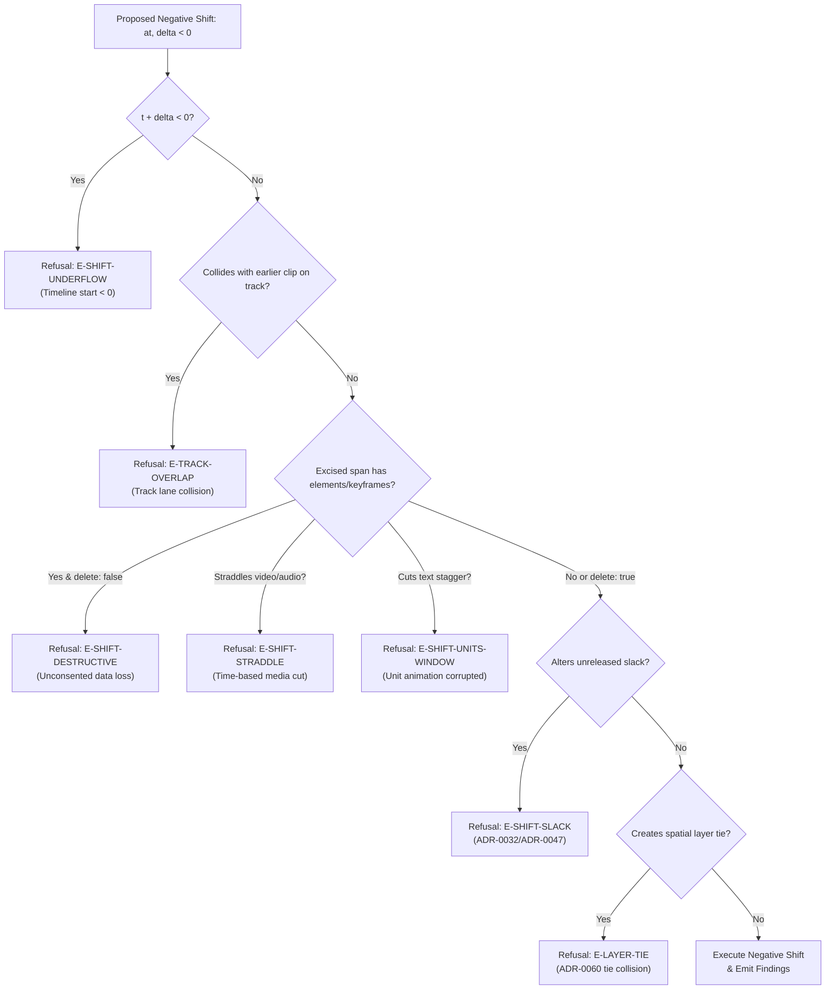

# Modeling Negative Shift and Ripple Operations in Montagent's Timeline

Research report resolving ticket [#979](https://github.com/MBehtemam/Montagent/issues/979), contributing to Premiere Parity [#978](https://github.com/MBehtemam/Montagent/issues/978).

Status: **Complete**  
Audience: Montagent core engineers, ADR authors, agent workflow designers  
Related documents:
- [`crates/montagent-core/src/verbs/shift.rs`](file:///Users/mohammedehtemam/.gemini/antigravity/worktrees/4efea133-5f2f-4da8-91ee-d033e8dae716/subagent-Negative-Shift-Researcher-self-6b3001bb/crates/montagent-core/src/verbs/shift.rs)
- [`docs/research/premiere-gap/editing.md`](file:///Users/mohammedehtemam/.gemini/antigravity/worktrees/4efea133-5f2f-4da8-91ee-d033e8dae716/subagent-Negative-Shift-Researcher-self-6b3001bb/docs/research/premiere-gap/editing.md)
- [`docs/adr/0012-flat-transform-keyframes-carried-by-their-element.md`](file:///Users/mohammedehtemam/.gemini/antigravity/worktrees/4efea133-5f2f-4da8-91ee-d033e8dae716/subagent-Negative-Shift-Researcher-self-6b3001bb/docs/adr/0012-flat-transform-keyframes-carried-by-their-element.md)
- [`docs/adr/0060-layer-tie-is-an-error-array-order-stays-meaningless.md`](file:///Users/mohammedehtemam/.gemini/antigravity/worktrees/4efea133-5f2f-4da8-91ee-d033e8dae716/subagent-Negative-Shift-Researcher-self-6b3001bb/docs/adr/0060-layer-tie-is-an-error-array-order-stays-meaningless.md)
- [`docs/adr/0019-layer-anchor-gets-an-id-a-validate-check-and-one-hop.md`](file:///Users/mohammedehtemam/.gemini/antigravity/worktrees/4efea133-5f2f-4da8-91ee-d033e8dae716/subagent-Negative-Shift-Researcher-self-6b3001bb/docs/adr/0019-layer-anchor-gets-an-id-a-validate-check-and-one-hop.md)
- [`docs/adr/0032-slack-is-invariant-shift-refuses-compare-is-the-backstop.md`](file:///Users/mohammedehtemam/.gemini/antigravity/worktrees/4efea133-5f2f-4da8-91ee-d033e8dae716/subagent-Negative-Shift-Researcher-self-6b3001bb/docs/adr/0032-slack-is-invariant-shift-refuses-compare-is-the-backstop.md)
- [`docs/adr/0047-shift-releases-slack-by-boundary-instant-pairs.md`](file:///Users/mohammedehtemam/.gemini/antigravity/worktrees/4efea133-5f2f-4da8-91ee-d033e8dae716/subagent-Negative-Shift-Researcher-self-6b3001bb/docs/adr/0047-shift-releases-slack-by-boundary-instant-pairs.md)
- [`docs/adr/0036-shift-preambles-coincident-instants-validate-and-compare-stay-out.md`](file:///Users/mohammedehtemam/.gemini/antigravity/worktrees/4efea133-5f2f-4da8-91ee-d033e8dae716/subagent-Negative-Shift-Researcher-self-6b3001bb/docs/adr/0036-shift-preambles-coincident-instants-validate-and-compare-stay-out.md)
- [`CONTEXT.md`](file:///Users/mohammedehtemam/.gemini/antigravity/worktrees/4efea133-5f2f-4da8-91ee-d033e8dae716/subagent-Negative-Shift-Researcher-self-6b3001bb/CONTEXT.md)

---

## 1. Executive Summary

In Montagent's timeline, `shift` is defined as *"the one edit that is arithmetic rather than authorship, and therefore the one Montagent performs instead of the agent"* ([CONTEXT.md](file:///Users/mohammedehtemam/.gemini/antigravity/worktrees/4efea133-5f2f-4da8-91ee-d033e8dae716/subagent-Negative-Shift-Researcher-self-6b3001bb/CONTEXT.md#L847-L856)). In v0.2.0, `shift` accepts only a strictly positive `delta > 0`. This restriction was identified in [`docs/research/premiere-gap/editing.md`](file:///Users/mohammedehtemam/.gemini/antigravity/worktrees/4efea133-5f2f-4da8-91ee-d033e8dae716/subagent-Negative-Shift-Researcher-self-6b3001bb/docs/research/premiere-gap/editing.md#L233-L237) as the single largest lever blocking parity with Adobe Premiere Pro editing workflows: **Extract**, **Ripple Delete**, **Close Gap**, **Shortening Ripple Trims**, and **Ripple Speed Changes** are all partial or manual for this one reason.

This report establishes:
1. **Why negative delta was deferred**: Positive shift inserts empty time monotonically via `SPLIT`, which preserves all keyframes and ordering. Excising time is inherently asymmetrical: it cannot be achieved by running `SPLIT` backwards, drops keyframes inside the cut, risks inverting element durations ($end \le start$) or timeline origins ($t < 0$), and can cause track collisions (`E-TRACK-OVERLAP`).
2. **How ripple deletions should be modeled**: Rather than introducing a tenth/eleventh MCP verb (which violates the context cost model of [ADR-0009](file:///Users/mohammedehtemam/.gemini/antigravity/worktrees/4efea133-5f2f-4da8-91ee-d033e8dae716/subagent-Negative-Shift-Researcher-self-6b3001bb/docs/adr/0009-rust-host.md) and [ADR-0011](file:///Users/mohammedehtemam/.gemini/antigravity/worktrees/4efea133-5f2f-4da8-91ee-d033e8dae716/subagent-Negative-Shift-Researcher-self-6b3001bb/docs/adr/0011-tool-surface-reads-checks-renders.md)), `shift` must be extended to accept signed `delta < 0`. It operates in two tiers:
   - **Safe Gap Closure (Default, `delete: false`)**: Excises empty track space/gaps. Refuses if any element or keyframe exists within the removed window $[at, at + |\delta|)$. Requires explicit slack release via `release` ([ADR-0047](file:///Users/mohammedehtemam/.gemini/antigravity/worktrees/4efea133-5f2f-4da8-91ee-d033e8dae716/subagent-Negative-Shift-Researcher-self-6b3001bb/docs/adr/0047-shift-releases-slack-by-boundary-instant-pairs.md)).
   - **Destructive Extraction (`delete: true`)**: Used for Extract and Ripple Delete of timeline spans. Permitted only when explicitly opted into; permanently removes whole elements and drops keyframes inside $[at, at + |\delta|)$, while enumerating every destroyed entity individually in the report receipt per [ADR-0012](file:///Users/mohammedehtemam/.gemini/antigravity/worktrees/4efea133-5f2f-4da8-91ee-d033e8dae716/subagent-Negative-Shift-Researcher-self-6b3001bb/docs/adr/0012-flat-transform-keyframes-carried-by-their-element.md).
3. **Keyframe interaction**: Keyframes are local animation geometry carried with their elements. Elements completely downstream of the excised range shift their entire keyframe lists by $\delta$ with bit-identical relative timing and bezier shapes. Keyframes within the cut span are deleted. Time-based straddlers (`video`, `audio`) are strictly refused (`E-SHIFT-STRADDLE`). Time-invariant straddlers evaluate boundary values at $at$ and synthesize step holds.
4. **Exact Tool Signatures**: Complete schemas for MCP `shift` and the CLI `montagent shift` (with `--from`/`--to` sugar and `--delete` flag).

---

## 2. Background and Primary Source Investigation

### 2.1 The Current `shift.rs` Implementation and Deferral Rationale

The `shift` verb in `crates/montagent-core/src/verbs/shift.rs` moves every timestamp at or after `at` by `delta`:
```rust
pub struct Ask {
    pub at: i64,
    pub delta: i64,
    pub scope: Option<String>,
    pub release: Vec<(i64, i64)>,
}
```
Currently, lines 122–130 reject non-positive deltas:
```rust
if ask.delta <= 0 {
    return refused(Report::rejected(
        TOOL,
        project_name,
        "`delta` must be a positive number of milliseconds; a non-positive `delta` is \
         refused rather than shipped half-reasoned (see the module note on negative \
         `delta`)",
    ));
}
```
The module documentation (lines 23–32) explains why negative delta was set aside:
> *"**`delta` must be positive.** ADR-0012 also specifies a negative, destructive `delta` — dropping every keyframe in the removed span and naming each one — and that mechanism does not reduce to SPLIT run backwards: the two new records SPLIT writes can invert their own order, and a large enough removal can reach past its own segment's earlier endpoint. None of #220's acceptance criteria exercise it, so a negative `delta` is refused here rather than shipped half-reasoned; it is a follow-up ticket's, not a silent gap in this one."*

### 2.2 ADR-0012: The Keyframe Carriage Rule & Destructive Clause

[ADR-0012](file:///Users/mohammedehtemam/.gemini/antigravity/worktrees/4efea133-5f2f-4da8-91ee-d033e8dae716/subagent-Negative-Shift-Researcher-self-6b3001bb/docs/adr/0012-flat-transform-keyframes-carried-by-their-element.md) establishes that transform keyframes are stored in absolute timeline milliseconds `t` on the element, but are conceptually **carried with the element**:
- When an element starts at or after `at`, all its keyframes shift by `delta`.
- When an element ends at or before `at`, all its keyframes remain untouched.
- When an element straddles `at`, the keyframe list is split via `SPLIT` (De Casteljau subdivision of the entering bezier curve at `fraction = (at - a.t) / (b.t - a.t)`).

Crucially, ADR-0012 lines 267–270 anticipates negative delta:
> *"Negative delta is destructive and must say so. Removing time drops every keyframe in `[at, at+|delta|)`. Nothing in ADR-0005 or ADR-0011 permits `shift` to destroy data; under this rule it can, and each destroyed keyframe is named individually in the report."*

### 2.3 ADR-0060 & ADR-0004: Track Non-Overlap and Stacking Invariants

[ADR-0004](file:///Users/mohammedehtemam/.gemini/antigravity/worktrees/4efea133-5f2f-4da8-91ee-d033e8dae716/subagent-Negative-Shift-Researcher-self-6b3001bb/docs/adr/0004-tracks-as-constrained-lanes.md) and [ADR-0060](file:///Users/mohammedehtemam/.gemini/antigravity/worktrees/4efea133-5f2f-4da8-91ee-d033e8dae716/subagent-Negative-Shift-Researcher-self-6b3001bb/docs/adr/0060-layer-tie-is-an-error-array-order-stays-meaningless.md) enforce:
1. **Intra-track non-overlap**: Elements within the same track cannot overlap in time (`E-TRACK-OVERLAP`). A track is a constrained lane. Array order has zero meaning.
2. **Inter-track layer ties**: If two elements on different tracks share an integer `layer`, they may not overlap in both space and time. Moving an element earlier on the timeline can pull it into temporal overlap with an element on another track that shares the same layer, triggering an `E-LAYER-TIE`.

### 2.4 ADR-0019: Element IDs and Anchor Constraints

[ADR-0019](file:///Users/mohammedehtemam/.gemini/antigravity/worktrees/4efea133-5f2f-4da8-91ee-d033e8dae716/subagent-Negative-Shift-Researcher-self-6b3001bb/docs/adr/0019-layer-anchor-gets-an-id-a-validate-check-and-one-hop.md) defines element layer anchors (`{"below": "target-id"}`). If an element is shifted such that it no longer temporally intersects its anchor target, the anchor becomes an inert no-op, raising a `review` finding (`R-ANCHOR-DISJOINT`). If a project-wide negative shift moves both elements, their relative temporal alignment is preserved.

### 2.5 ADR-0032, ADR-0047, and ADR-0036: Slack Invariance and Coincident Instants

- **ADR-0032**: All slacks (gaps within tracks, lead-outs across tracks) are invariant by default. `shift` refuses to silently absorb or alter them (`E-SHIFT-SLACK`).
- **ADR-0047**: Slacks altered by `shift` must be explicitly released by enumerating their exact `[start, end]` boundary-instant pairs in the `release` parameter.
- **ADR-0036**: `shift` prints an unconditional preamble for every record (element boundary or keyframe) sitting at a coincident instant `at`, declaring exactly what the verb will do to it.

### 2.6 Premiere Gap Inventory (`editing.md`)

The Premiere feature gap audit in [`docs/research/premiere-gap/editing.md`](file:///Users/mohammedehtemam/.gemini/antigravity/worktrees/4efea133-5f2f-4da8-91ee-d033e8dae716/subagent-Negative-Shift-Researcher-self-6b3001bb/docs/research/premiere-gap/editing.md) identifies negative `shift` as the missing core primitive across multiple standard NLE operations:
- **Extract (`'`)** (line 141): Removes material between In and Out and closes the gap.
- **Ripple Delete / Close Gap** (line 150): Removes clips or empty space and pulls downstream clips earlier.
- **Ripple Trim** (line 146): Shortening an In or Out point and pulling downstream clips left.
- **Notable Gap #1** (lines 233–237):
  > *"`shift` refuses a negative `delta`. Extract, ripple delete, close gap, shortening ripple trims, asymmetrical trims and ripple speed changes are all partial for this one reason. ADR-0012 already specifies the mechanism, and `shift.rs` defers it to a follow-up. It is the biggest lever in this chapter."*

---

## 3. Core Question 1: Failure Modes and Invariants Under Negative Shift

### 3.1 Why Contraction is Not Inverted `SPLIT`

In forward shift (`delta > 0`):
- Time is inserted. A point $at$ expands into an interval $[at, at + \delta)$.
- Keyframe lists are partitioned: records before $at$ stay; records after $at$ move to $t + \delta$.
- If $at$ falls inside an animated segment, `split_keyed` samples the curve at $fraction$, creates a keyframe at $at$, inserts a step hold across $[at, at + \delta)$, and resumes from $at + \delta$.
- Monotonicity is guaranteed: $at < at + \delta$. No keyframe is destroyed. Element durations increase.

In negative shift ($\delta < 0$, with magnitude $\Delta = |\delta|$):
- Time is excised. An interval $[at, at + \Delta)$ is excised from the timeline.
- Downstream timestamps move earlier: $t \leftarrow t - \Delta$ for $t \ge at + \Delta$.
- Running `SPLIT` in reverse is mathematically ill-posed:
  1. A curve segment cannot be cleanly reconstructed if a slice of its time domain was deleted; the derivative at the entering seam will not match the derivative at the leaving seam, causing an abrupt motion transient (kink).
  2. If $\Delta$ exceeds the distance between keyframes, intermediate keyframes fall inside $[at, at + \Delta)$ and are lost.
  3. If $\Delta$ exceeds an element's duration, the element would invert or vanish.

### 3.2 Exhaustive Failure Modes Catalog

Any implementation of negative shift must validate against eight distinct failure modes before modifying the project file:



#### 1. Timeline Underflow (`E-SHIFT-UNDERFLOW`)
- **Condition**: An element or keyframe with original timestamp $t \ge at + \Delta$ satisfies $t - \Delta < 0$, or an edit specifies $at - \Delta < 0$.
- **Invariant**: Montagent timelines are defined on non-negative integer milliseconds ($t \ge 0$, [ADR-0005](file:///Users/mohammedehtemam/.gemini/antigravity/worktrees/4efea133-5f2f-4da8-91ee-d033e8dae716/subagent-Negative-Shift-Researcher-self-6b3001bb/docs/adr/0005-absolute-integer-milliseconds.md)).
- **Action**: Refuse before mutation. Report the earliest invalid timestamp and the offending element.

#### 2. Track Collision / Knot Formation (`E-TRACK-OVERLAP`)
- **Condition**: An element $B$ on track $T$ starting at $start_B \ge at + \Delta$ moves left to $start_B - \Delta$. If an earlier element $A$ on track $T$ ended at $end_A > start_B - \Delta$, element $B$ overlaps element $A$.
- **Invariant**: Tracks are constrained lanes that forbid time overlap ([ADR-0004](file:///Users/mohammedehtemam/.gemini/antigravity/worktrees/4efea133-5f2f-4da8-91ee-d033e8dae716/subagent-Negative-Shift-Researcher-self-6b3001bb/docs/adr/0004-tracks-as-constrained-lanes.md), [ADR-0060](file:///Users/mohammedehtemam/.gemini/antigravity/worktrees/4efea133-5f2f-4da8-91ee-d033e8dae716/subagent-Negative-Shift-Researcher-self-6b3001bb/docs/adr/0060-layer-tie-is-an-error-array-order-stays-meaningless.md)).
- **Action**: Refuse before mutation. Name the colliding elements, the track name, and the overlap interval $[start_B - \Delta, end_A)$.

#### 3. Non-Positive Element Duration / Collapse (`E-ELEMENT-COLLAPSE`)
- **Condition**: A negative shift cuts partially through an element, moving its end earlier while leaving its start unchanged, such that $end - \Delta \le start$.
- **Invariant**: Every timeline element must have strictly positive duration: $end > start$ (minimum 1 ms, [CONTEXT.md](file:///Users/mohammedehtemam/.gemini/antigravity/worktrees/4efea133-5f2f-4da8-91ee-d033e8dae716/subagent-Negative-Shift-Researcher-self-6b3001bb/CONTEXT.md#L691-L697)).
- **Action**: Refuse unless the element is wholly within the excised span and `delete: true` is set.

#### 4. Time-Based Media Straddling (`E-SHIFT-STRADDLE`)
- **Condition**: A `video` or `audio` element straddles $at$ or $at + \Delta$ ($start < at < end$ or $start < at + \Delta < end$).
- **Invariant**: Time-based elements have synchronized internal source playback clocks (`source_start`, `source_end`, `speed`). Slicing time out of a video/audio element requires splitting it into two distinct elements with separate source ranges or trimming head/tail. Because `shift` cannot invent element IDs or make authoring choices about source alignment ([ADR-0005](file:///Users/mohammedehtemam/.gemini/antigravity/worktrees/4efea133-5f2f-4da8-91ee-d033e8dae716/subagent-Negative-Shift-Researcher-self-6b3001bb/docs/adr/0005-absolute-integer-milliseconds.md), [ADR-0011](file:///Users/mohammedehtemam/.gemini/antigravity/worktrees/4efea133-5f2f-4da8-91ee-d033e8dae716/subagent-Negative-Shift-Researcher-self-6b3001bb/docs/adr/0011-tool-surface-reads-checks-renders.md)), mid-element cuts on time-based elements are strictly forbidden.
- **Action**: Refuse and report the nearest legal cut points ($start$ and $end$).

#### 5. Unconsented Data Destruction (`E-SHIFT-DESTRUCTIVE`)
- **Condition**: Calling `shift` with `delta < 0` when `delete: false` (the default) while elements or keyframes exist in $[at, at + \Delta)$.
- **Invariant**: Montagent write tools do not silently discard authored elements or keyframes.
- **Action**: Refuse. Enumerate all elements and keyframes that reside within $[at, at + \Delta)$. Direct the caller to pass `delete: true` or clear the gap first.

#### 6. Text Stagger Window Corruption (`E-SHIFT-UNITS-WINDOW`)
- **Condition**: The excised range $[at, at + \Delta)$ intersects a text element's active unit stagger animation window.
- **Invariant**: [ADR-0151](file:///Users/mohammedehtemam/.gemini/antigravity/worktrees/4efea133-5f2f-4da8-91ee-d033e8dae716/subagent-Negative-Shift-Researcher-self-6b3001bb/docs/adr/0151-text-unit-stagger-is-a-derived-window.md) §5 forbids slicing into the derived per-word/per-character window.
- **Action**: Refuse and report the text element and its unit window boundaries.

#### 7. Slack Invariance Violations (`E-SHIFT-SLACK`)
- **Condition**: The negative shift closes or narrows a gap or lead-out that was not explicitly listed in `release`.
- **Invariant**: Every slack is invariant by default ([ADR-0032](file:///Users/mohammedehtemam/.gemini/antigravity/worktrees/4efea133-5f2f-4da8-91ee-d033e8dae716/subagent-Negative-Shift-Researcher-self-6b3001bb/docs/adr/0032-slack-is-invariant-shift-refuses-compare-is-the-backstop.md), [ADR-0047](file:///Users/mohammedehtemam/.gemini/antigravity/worktrees/4efea133-5f2f-4da8-91ee-d033e8dae716/subagent-Negative-Shift-Researcher-self-6b3001bb/docs/adr/0047-shift-releases-slack-by-boundary-instant-pairs.md)).
- **Action**: Refuse with `E-SHIFT-SLACK`, printing the exact `[from, to]` pairs that must be passed to `release`.

#### 8. Inter-Track Layer Tie Collision (`E-LAYER-TIE`)
- **Condition**: Moving an element earlier causes it to temporally overlap an element on another track with the same resolved integer `layer` where their spatial bounding boxes intersect.
- **Invariant**: Layer ties with temporal and spatial overlap are validation errors ([ADR-0060](file:///Users/mohammedehtemam/.gemini/antigravity/worktrees/4efea133-5f2f-4da8-91ee-d033e8dae716/subagent-Negative-Shift-Researcher-self-6b3001bb/docs/adr/0060-layer-tie-is-an-error-array-order-stays-meaningless.md)).
- **Action**: Detect during pre-flight check and refuse.

---

## 4. Core Question 2: Modeling Ripple Deletions

### 4.1 Comparison of Candidate Models

We evaluate four structural options for modeling negative shift and ripple deletions:

| Model | Schema Shape | Mechanism | Trade-offs & Alignment |
|---|---|---|---|
| **Model A: Negative Offset** | `shift(at, delta)` with `delta < 0` | Elements at/after $at + \|\delta\|$ shift left by $\|\delta\|$. | Clean, symmetric with positive shift. Requires clarifying whether $at$ is cut start or cut end. |
| **Model B: Target Range** | `shift(from, to)` or `shift(range: [a, b])` | Interval $[from, to)$ is excised; elements after $to$ shift left by $to - from$. | Extremely intuitive for range extraction and gap closure. However, asymmetric with positive `shift(at, delta)` if both coexist. |
| **Model C: Dedicated Verb** | `ripple_delete(project, from, to)` | New MCP and CLI verb specifically for deleting material and rippling. | **Rejected**: Violates ADR-0011/ADR-0009 context budget. Burning an MCP schema slot on an operation expressible through `shift` is unacceptable. |
| **Model D: Two-Step Editing** | Agent deletes element $\to$ `shift` closes gap | Agent removes element JSON, leaving a gap; calls `shift` to pull trailing elements. | Fully compliant with ADR-0011 write invariant. Already works conceptually in `editing.md`, but needs `shift` to support gap closure. |

### 4.2 The Recommended Model: Unified Two-Tier `shift`

We recommend unifying these needs inside the existing `shift` tool by:
1. Allowing signed `delta` (both positive and negative).
2. Establishing **Convention 2 (Cut-Origin Convention)**:
   - For `delta > 0`: `at` is the insertion point. Interval $[at, at + \delta)$ is opened. Elements at or after $at$ move right by $\delta$.
   - For `delta < 0`: `at` is the excision origin. Interval $[at, at + |\delta|)$ is removed. Elements at or after $at + |\delta|$ move left by $|\delta|$. Everything before $at$ is untouched.
3. Adding a boolean `delete` parameter (default: `false`):
   - **`delete: false` (Gap Closure Mode)**: The excised interval $[at, at + |\delta|)$ must be empty of elements and keyframes on the affected tracks. If an element or keyframe exists in $[at, at + |\delta|)$, the call refuses with `E-SHIFT-DESTRUCTIVE`. Closing a gap is fully non-destructive; it only requires releasing the gap's slack via `release: [[at, at + |delta|]]`.
   - **`delete: true` (Extraction / Ripple Delete Mode)**: Elements wholly contained within $[at, at + |\delta|)$ are deleted. Keyframes within $[at, at + |\delta|)$ on time-invariant straddlers are dropped. Every deleted element ID and dropped keyframe is enumerated in the report receipt. Time-based elements straddling the cut are still refused (`E-SHIFT-STRADDLE`).
4. Supporting `--from <MS> --to <MS>` syntax sugar in the CLI, which maps directly to `at = from` and `delta = -(to - from)`.

---

## 5. Core Question 3: Interaction with Keyframes & Animation Geometry

### 5.1 Local Geometry Carried with Elements

[ADR-0012](file:///Users/mohammedehtemam/.gemini/antigravity/worktrees/4efea133-5f2f-4da8-91ee-d033e8dae716/subagent-Negative-Shift-Researcher-self-6b3001bb/docs/adr/0012-flat-transform-keyframes-carried-by-their-element.md) dictates that keyframes belong to their element.
When a negative shift moves an element whose entire lifetime is downstream ($start \ge at + \Delta$):
$$start' = start - \Delta$$
$$end' = end - \Delta$$
$$\forall k \in \text{keyframes},\quad k.t' = k.t - \Delta$$
Because every keyframe shifts by the exact same constant offset $\Delta$:
- Relative intervals $k_{i+1}.t' - k_i.t' = k_{i+1}.t - k_i.t$ are preserved bit-for-bit.
- All cubic bezier control points $(x_1, y_1, x_2, y_2)$ remain completely unchanged.
- No keyframes are dropped, reordered, or subdivided.
- Easing trajectories and animations render identically, translated earlier in time.

### 5.2 Straddling Keyframes and Dropped Keyframe Receipts

When a time-invariant straddler has keyframes inside the excised interval $[at, at + \Delta)$:
1. **Keyframes before the cut ($t \le at$)**: Retained with unchanged $t$.
2. **Keyframes inside the cut ($at < t < at + \Delta$)**: Dropped. Under ADR-0012, this is destructive data loss. `shift` emits an explicit receipt section naming each dropped keyframe by property name, original timestamp $t$, and value $v$.
3. **Keyframes after the cut ($t \ge at + \Delta$)**: Retained and shifted: $t' = t - \Delta$.

### 5.3 Boundary Value Evaluation and Seam Discontinuity

If a cut occurs mid-animation across an entering curve segment between keyframe $A$ ($t_A < at$) and keyframe $B$ ($t_B > at + \Delta$):
- Before cut: value at $at$ is $v_1 = \text{evaluate}(A, B, at)$.
- Before cut: value at $at + \Delta$ is $v_2 = \text{evaluate}(A, B, at + \Delta)$.
- When $[at, at + \Delta)$ is excised, the instant $at$ and the instant $at + \Delta$ collapse into the single point $at$.
- If $v_1 \ne v_2$, joining them smoothly is impossible without altering author intent.
- **Rule**:
  1. A boundary keyframe is synthesized at $t = at$ with value $v_1$.
  2. The downstream segment entering from the cut receives a `step` ease (`Ease::Named(EaseName::Step)`), holding $v_1$ until the next post-cut keyframe, or step-transitioning to $v_2$.
  3. Any consecutive identical holds created are collapsed via `collapse_holds` (Step 7 of `shift.rs`).

---

## 6. Core Question 4: Proposed Schema and CLI/MCP Signatures

### 6.1 MCP Tool Parameter Schema (`ShiftParams`)

In `crates/montagent/src/mcp.rs`, the schema for `shift` is updated:

```rust
/// `shift`'s arguments: the one edit that is arithmetic rather than authorship.
#[derive(Debug, serde::Deserialize, schemars::JsonSchema)]
pub struct ShiftParams {
    /// Path to the project file.
    pub project: String,

    /// The instant where shift begins, in absolute milliseconds.
    /// - If delta > 0: time is inserted at `at`.
    /// - If delta < 0: time is excised starting at `at` across [at, at + |delta|).
    pub at: i64,

    /// The offset in milliseconds.
    /// May be positive (insert time) or negative (excise time / ripple).
    pub delta: i64,

    /// Narrow the edit to one track's elements. Omit for project-wide.
    #[serde(default)]
    pub scope: Option<String>,

    /// Every slack this edit changes, named as its full boundary-instant pair
    /// [[from, to], ...]. Required whenever a gap or lead-out is altered.
    #[serde(default)]
    pub release: Vec<[i64; 2]>,

    /// Permit destructive deletion of elements wholly contained within [at, at + |delta|)
    /// and dropping of keyframes within that range. Defaults to false.
    /// When false, shift refuses if any element or keyframe exists in the excised range.
    #[serde(default)]
    pub delete: bool,

    /// Return canonical JSON instead of text report.
    #[serde(default)]
    pub json: bool,

    /// Verbose output.
    #[serde(default)]
    pub verbose: bool,
}
```

#### Complete JSON Schema for MCP `shift`
```json
{
  "type": "object",
  "required": ["project", "at", "delta"],
  "properties": {
    "project": {
      "type": "string",
      "description": "Path to the project file."
    },
    "at": {
      "type": "integer",
      "description": "Instant where shift begins, in absolute milliseconds."
    },
    "delta": {
      "type": "integer",
      "description": "Offset in milliseconds. Positive to insert time, negative to excise time / ripple."
    },
    "scope": {
      "type": "string",
      "description": "Track name to restrict the shift to. Omit for the whole project."
    },
    "release": {
      "type": "array",
      "items": {
        "type": "array",
        "items": { "type": "integer" },
        "minItems": 2,
        "maxItems": 2
      },
      "description": "Boundary-instant pairs [[from, to], ...] of all slacks this edit alters."
    },
    "delete": {
      "type": "boolean",
      "default": false,
      "description": "Permit destructive removal of elements and keyframes in the excised span."
    },
    "json": {
      "type": "boolean",
      "default": false,
      "description": "Return JSON instead of text report."
    },
    "verbose": {
      "type": "boolean",
      "default": false
    }
  }
}
```

### 6.2 CLI Subcommand Interface

In `crates/montagent/src/cli.rs`:

```rust
/// Move every time at or after an instant, or excise a time range.
Shift {
    /// The project file.
    project: PathBuf,

    /// The instant to shift at or after, in absolute milliseconds.
    #[arg(long, value_name = "MS", conflicts_with = "from")]
    at: Option<i64>,

    /// The offset, in milliseconds. Can be positive or negative.
    #[arg(long, value_name = "MS", conflicts_with = "to")]
    delta: Option<i64>,

    /// Range start for excise / ripple delete (paired with --to).
    #[arg(long, value_name = "MS", requires = "to", conflicts_with = "at")]
    from: Option<i64>,

    /// Range end for excise / ripple delete (paired with --from).
    #[arg(long, value_name = "MS", requires = "from", conflicts_with = "delta")]
    to: Option<i64>,

    /// Narrow the edit to one track.
    #[arg(long, value_name = "TRACK")]
    scope: Option<String>,

    /// A slack this edit changes, named as FROM,TO. Repeatable.
    #[arg(long = "release", value_name = "FROM,TO")]
    release: Vec<String>,

    /// Permit deleting elements and keyframes in the excised span.
    #[arg(long)]
    delete: bool,

    #[arg(long)]
    json: bool,

    #[arg(long, short)]
    verbose: bool,
}
```

CLI Usage Examples:
```bash
# 1. Close a 500 ms gap between 1200 ms and 1700 ms (non-destructive):
montagent shift project.json --at 1200 --delta -500 --release 1200,1700

# 2. Same gap closure using range sugar:
montagent shift project.json --from 1200 --to 1700 --release 1200,1700

# 3. Ripple delete / Extract material between 5000 ms and 8000 ms:
montagent shift project.json --from 5000 --to 8000 --delete --release 5000,8000
```

### 6.3 Receipt and Wire Output Format

When executing a negative shift that drops keyframes or deletes elements under `--delete`, `render_shift` outputs a structured receipt alongside `validate` findings:

```text
SHIFT: excised 3000 ms [5000..8000) across 3 tracks
  deleted elements:
    - title-card-02 (text, track: titles, [5000..7500))
  dropped keyframes:
    - photo-01.scale: t=6200, v=1.05
    - photo-01.opacity: t=7800, v=0.0
  released slacks:
    - [5000, 8000] (gap on titles track)
  summary: 12 elements moved earlier by 3000 ms.

0 errors, 0 review, 1 note (shift runs validate)
```

---

## 7. Concrete Implementation Plan & Test Matrix

### 7.1 New Core Finding Codes

| Code | Severity | Description |
|---|---|---|
| `E-SHIFT-UNDERFLOW` | Error / Refuse | Element or keyframe would land at $t < 0$. |
| `E-SHIFT-COLLISION` | Error / Refuse | Shifted element collides with an unshifted element on the same track (`E-TRACK-OVERLAP`). |
| `E-SHIFT-DESTRUCTIVE` | Error / Refuse | Elements or keyframes exist in excised span and `delete: true` was not provided. |
| `E-ELEMENT-COLLAPSE` | Error / Refuse | Shift causes an element duration to become $\le 0$. |
| `W-KEYFRAME-DROPPED` | Note / Receipt | Records a keyframe dropped by an excision under `delete: true`. |
| `W-ELEMENT-DROPPED` | Note / Receipt | Records a whole element removed by an excision under `delete: true`. |

### 7.2 Implementation Phases

1. **Phase 1: Safe Gap Closure (`delta < 0`, `delete: false`)**:
   - Update `Ask` validation in `shift.rs` to allow `delta < 0`.
   - Implement pre-flight collision check against existing track elements.
   - Implement underflow check ($t < 0$).
   - Implement check ensuring $[at, at + |\delta|)$ contains no elements or keyframes.
   - Shift elements with $start \ge at + |\delta|$ by $\delta$.
   - Verify slack checks handle narrowing/closure with `release`.
2. **Phase 2: Range Extraction (`delete: true`)**:
   - Add `delete: bool` to `Ask` and `ShiftParams`.
   - Implement whole-element excision for elements whose range is contained within $[at, at + |\delta|)$.
   - Implement keyframe dropping and seam step-holding for time-invariant straddlers.
   - Format dropped keyframes and deleted elements into report receipt.
3. **Phase 3: CLI & Wire Formatter**:
   - Add `--from`/`--to` syntax sugar and `--delete` to CLI.
   - Add dropped keyframe reporting to `montagent_core::wire::render_shift`.

### 7.3 Test Matrix

A comprehensive suite in `crates/montagent-core/tests/shift_negative.rs` should verify:
1. `negative_shift_closes_gap_cleanly`: Project with 400 ms gap at 1000 ms closes to 0 ms with `delta = -400` and `release = [[1000, 1400]]`.
2. `negative_shift_underflow_refused`: Attempting to shift elements at 500 ms by -1000 ms produces `E-SHIFT-UNDERFLOW`.
3. `negative_shift_collision_refused`: Shifting element starting at 2000 ms by -800 ms when previous element ends at 1500 ms produces `E-TRACK-OVERLAP` / `E-SHIFT-COLLISION`.
4. `negative_shift_destructive_refusal_without_flag`: Excising $[1000, 2000)$ containing an element without `delete: true` produces `E-SHIFT-DESTRUCTIVE`.
5. `negative_shift_destructive_extraction_with_flag`: Excising $[1000, 2000)$ with `delete: true` removes the contained element, shifts downstream elements, and lists the deleted element in the receipt.
6. `negative_shift_keyframes_carried_isomorphically`: Downstream element with 5 transform keyframes moves earlier by 1000 ms; all keyframes preserve relative spacing and bezier easing.
7. `negative_shift_time_based_straddler_refused`: Slicing through an audio or video element produces `E-SHIFT-STRADDLE`.
8. `negative_shift_slack_invariance_enforced`: Closing a gap without naming it in `release` produces `E-SHIFT-SLACK`.
9. `negative_shift_track_scoped`: Narrowing negative shift to one track alters only that track's elements and checks for collisions within that track.
